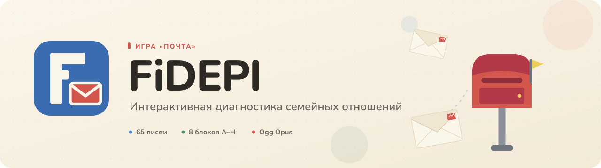

<div align="center">
  
  <h1>FiDEPI · Почта</h1>
  <p><strong>Интерактивная диагностика эмоциональных отношений в семье</strong></p>
  <p>Браузерная игра, в которой ребёнок создаёт свою семью, получает письма и раскладывает их по почтовым ящикам.</p>

  <p>
    
    
    
    
    
    
  </p>

  <p>
    <a href="https://backspace-08.github.io/FiDEPI/"><strong>Открыть игру</strong></a>
    &nbsp;·&nbsp;
    <a href="https://backspace-08.github.io/FiDEPI/?preview-results">Демо результата</a>
  </p>
</div>

<p align="center">
  
</p>

> **FiDEPI** — Framework for Interactive Diagnostics, Evaluation, Psychology and Interaction.  
> «Почта» — первая игра платформы: адаптация методики Бене–Антони в формате почтовой игры для детей.

## О проекте

Ребёнок не отвечает на вопросы «в лоб». Он **создаёт свою семью** из бумажных персонажей, получает **65 писем** с утверждениями и раскладывает их по почтовым ящикам — тому члену семьи, которому письмо подходит больше всего. Если адресата нет, письмо уходит **Незнакомцу**.

Игра сохраняет ритуал оригинальной методики — фигуры, карточки, ящики, «Никто» — но убирает бумажную рутину: ответы фиксируются автоматически, письма можно послушать, а результат собирается в отчёты для ребёнка, родителя и психолога.

Проект сделан как **frontend-MVP**: без бэкенда, с локальным сохранением прогресса и демонстрационными кодами доступа к взрослым отчётам.

## Что внутри

| 65 | 8 | 68 | 83 | 3 |
|:---:|:---:|:---:|:---:|:---:|
| писем-утверждений | блоков A–H | SVG-ассетов | озвученных файлов | отчёта |

- **Конструктор семьи** — до 8 персонажей: имя, пол, возраст, волосы, одежда.
- **Бумажные куклы** — персонажи собираются из слоистых SVG, как в бумажном театре.
- **65 писем** — перемешиваются, летят из мешка, читаются в конверте и уходят в ящик.
- **Три отчёта** — детский, родительский и профессиональный; коды доступа для взрослых.
- **Озвучка** — 83 файла Ogg Opus, голос Ирины из Yandex SpeechKit; авто-режим и предзагрузка.
- **Сохранение** — семья и прогресс живут в `localStorage`; перезагрузка не убивает тест.
- **Адаптив** — мобильная раскладка и отдельная ПК-схема с мешком слева и навигацией справа.
- **Демо-режим результата** — `?preview-results` для быстрого показа отчётов.

## Методика

В основе — **«Диагностика эмоциональных отношений в семье» Е. Бене и Д. Антони**, адаптированная вместе с психологом заказчика.

| Блок | Направление | Что измеряет | Вопросов |
|---|---|---|---:|
| **A** | от ребёнка | положительные чувства к члену семьи | 10 |
| **B** | от ребёнка | слабые отрицательные чувства | 10 |
| **C** | от ребёнка | сильные отрицательные чувства | 8 |
| **D** | к ребёнку | положительное отношение члена семьи | 8 |
| **E** | к ребёнку | слабые отрицательные чувства, приписываемые члену семьи | 8 |
| **F** | к ребёнку | сильные отрицательные чувства, приписываемые члену семьи | 8 |
| **G** | — | материнская сверхопека | 8 |
| **H** | — | отцовское сверхпотакание | 5 |

**Подсчёт:**
- положительные: `P = A + D`;
- отрицательные: `N = B + C + E + F`;
- проценты считаются от `P + N`;
- `P ≥ 80%` — благополучная динамика, `N ≥ 60%` — неблагополучная, иначе норма;
- `G` и `H` показываются отдельно, без смешивания с P/N;
- «Никто» — отдельная фигура, не входит в общий результат семьи.

Для ребёнка и родителя результат обобщается по семье; для психолога — строго по каждому члену семьи, с блоками, долями и первичными ответами.

> Это не диагноз. Интерпретация — упрощённая модель, согласованная с заказчиком, а не валидированная автоматическая диагностика.

## Визуальный язык

Тёплая бумажная палитра: кремовый фон, синий для действий, коралловый для акцентов. Персонажи и реквизит — из SVG-ассетов заказчика, собранных в слоистую систему.

<p align="center">
  
  
</p>

<p align="center">
  
  
  
</p>

| Цвет | HEX | Роль |
|---|---|---|
| Кремовый | `#FBF6EA` | фон |
| Белый | `#FFFFFF` | карточки и письма |
| Тёплый ink | `#2E2A26` | основной текст |
| Синий | `#4B84D1` | действия |
| Тёмно-синий | `#3B6CB0` | фавиконка, акцент |
| Коралловый | `#D4574E` | акцент |
| Зелёный | `#4F8A63` | положительная динамика |
| Приглушённый красный | `#B4544F` | отрицательная динамика |
| Рамка | `#E4DDD0` | границы |

## Технологии

| Слой | Что используется |
|---|---|
| UI | Vue 3.5, Composition API, `<script setup>` |
| Сборка | Vite 8 |
| Язык | JavaScript, ES-модули |
| Стили | CSS-переменные, scoped CSS, flex/grid |
| Графика | 68 SVG, слоистая сборка персонажей |
| Анимации | Web Animations API + CSS |
| Звук | Yandex SpeechKit v3, Ogg Opus, Web Speech fallback |
| Состояние | `localStorage`: `fidepi-family`, `fidepi-assessment` |
| Деплой | GitHub Actions → GitHub Pages |

Без UI-кита, роутера и стейт-менеджера: для линейной игры это сознательное решение — меньше зависимостей и полный контроль над анимациями и раскладкой.

## Структура

```
src/
├─ App.vue                 # сцены, навигация, режим озвучки
├─ components/             # сцены, персонажи, письма, отчёты
├─ data/                   # вопросы, блоки, тексты, фразы
├─ lib/                    # scoring, assessment, audio
└─ avatars.js              # кропы аватаров

svg/
├─ layered/                # слоистые персонажи
└─ normalized/             # готовые фигуры и реквизит

public/
├─ audio/                  # 83 Ogg Opus файла
└─ favicon.svg

docs/
└─ banner.svg

base.css                   # дизайн-токены
index.html
```

## Запуск

Нужен Node.js 22+.

```bash
git clone https://github.com/backspace-08/FiDEPI.git
cd FiDEPI
npm install
npm run dev
```

- dev: `http://localhost:5173/`
- сборка: `npm run build`
- предпросмотр сборки: `npm run preview`

**Демо-режим результата:** `http://localhost:5173/?preview-results`

> Код родителя — `123456`, код психолога — `654321`.  
> Это клиентская демонстрация доступа, а не production-авторизация.

## Озвучка

- 83 файла в `public/audio`: 65 вопросов, 12 реплик психолога, 6 текстов результата.
- Формат — **Ogg Opus**, 48 кГц, моно.
- Голос — `irina`, роль `support`, модель `livetts` (Yandex SpeechKit v3).
- Файлы сгенерированы заранее: в рантайме API-ключ не нужен.
- Текущая реплика и следующий вопрос подгружаются заранее; при ошибке — fallback на Web Speech API.

Для пересборки озвучки нужны `YANDEX_AI_SPEECH_API_KEY` и `YANDEX_FOLDER_ID`; в репозитории лежат только готовые файлы.

## Деплой

- GitHub Pages.
- Деплой запускается пушем в ветку `production`.
- Workflow: `.github/workflows/deploy.yml`.
- `base: '/FiDEPI/'`.
- Живая версия: [backspace-08.github.io/FiDEPI](https://backspace-08.github.io/FiDEPI/).

## Статус

**Сделано:**
- весь игровой поток, создание и редактирование семьи;
- 65 вопросов, подсчёт по блокам, отчёты и коды доступа;
- озвучка, авто-режим, предзагрузка и fallback;
- сохранение прогресса и восстановление после перезагрузки;
- мобильная и ПК-раскладка;
- демо-режим результата и деплой.

**Дальше:**
- бэкенд и реальные ссылки/письма для родителя и психолога;
- PDF/CSV-отчёты и печать;
- «Секретная записка» и финальный экран;
- тесты, линтер, аудит доступности;
- финальная валидация интерпретации с психологом.

## Благодарности

- **Е. Бене и Д. Антони** — за методику «Диагностика эмоциональных отношений в семье».
- **Психологу и заказчику** — за адаптацию вопросов, блоков и текстов результатов.
- **Yandex SpeechKit** — за русский голос.
- **Nunito** и **Material Symbols Rounded** — за шрифт и иконки.

---

<div align="center">
  <sub>© 2026 <a href="https://github.com/backspace-08">backspace-08</a></sub>
</div>
