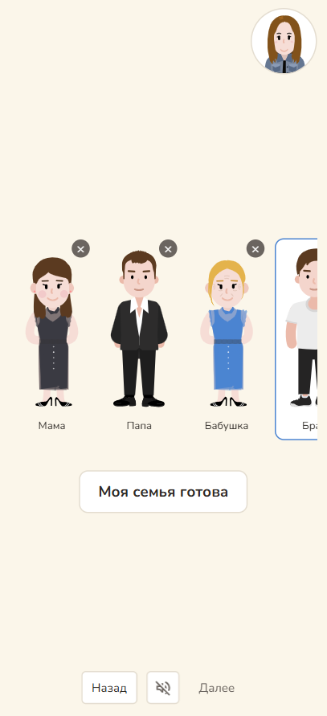
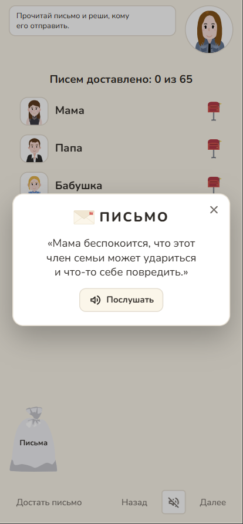
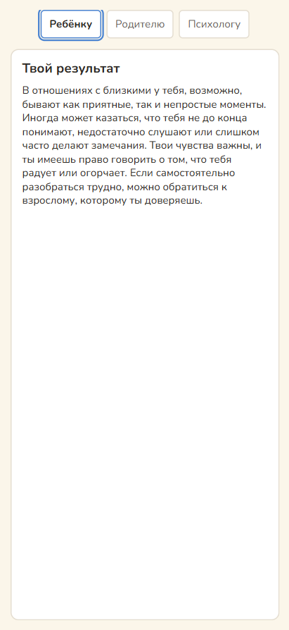

<div align="center">


<h1>FiDEPI · Почта</h1>

Браузерная игра, в которой ребёнок рассказывает о своей семье через письма и почтовые ящики

[Играть](https://backspace-08.github.io/FiDEPI/) · [Демо отчёта](https://backspace-08.github.io/FiDEPI/?preview-results)

[](https://vuejs.org)
[](https://vite.dev)

</div>

## О проекте

«Почта» — браузерная игра в рамках FiDEPI (Framework for Interactive Diagnostics, Evaluation, Psychology and Interaction). Это адаптация методики Бене–Антони «Диагностика эмоциональных отношений в семье»: ребёнок получает письма с короткими утверждениями и решает, кому из семьи каждое из них подходит.

Игра не ставит диагноз. Это упрощённая интерпретация для разговора со специалистом, а не замена консультации.

<p align="center">
  
  
  
</p>

## Как играет ребёнок

1. Собирает семью из слоистых SVG-персонажей, как бумажных кукол: имя, пол, возраст, причёска и одежда. В семье может быть до восьми человек.
2. Достаёт письмо из мешка и читает его сам или слушает. Всего 65 писем в восьми блоках методики, при каждом прохождении они перемешиваются. Озвучка состоит из 83 записей; её можно выключить, и тогда текст остаётся на экране.
3. Опускает письмо в ящик того, кому оно подходит. Если не подходит никому, письмо уходит Незнакомцу.
4. Смотрит отчёт. Детский и родительский показывают картину по семье в целом, профессиональный разбивает её по каждому члену семьи.

Родительский и профессиональный отчёты открываются по коду. В демо это `123456` для родителя и `654321` для психолога; проверка идёт на клиенте и не является production-авторизацией.

Ответы сохраняются в `localStorage`, поэтому прохождение можно прервать и продолжить. Для телефона и компьютера сделаны отдельные раскладки.

## Запуск

Нужен Node.js 22.12 или новее.

```bash
git clone https://github.com/backspace-08/FiDEPI.git
cd FiDEPI
npm install
npm run dev
```

Приложение открывается на `http://localhost:5173/`, демо отчёта — на `http://localhost:5173/?preview-results`. Сборка делается командой `npm run build`, предпросмотр сборки — `npm run preview`.

## Браузеры

Игра работает в актуальных Chrome, Edge, Firefox и Safari; анимациям нужен Safari 13.1 или новее. Записанная озвучка хранится в Ogg Opus, который Safari и iOS поддерживают с версии 18.4. На более старых версиях включается озвучка через Web Speech API, а если системного русского голоса нет, реплики остаются текстом. Подробности в [docs/audio.md](docs/audio.md).

## Документация

- [Методика](docs/methodology.md) — блоки, подсчёт, границы интерпретации.
- [Дизайн](docs/design.md) — палитра, типографика, SVG-персонажи.
- [Озвучка](docs/audio.md) — формат, голос, предзагрузка, ограничения браузеров.
- [Архитектура](docs/architecture.md) — стек, структура проекта, сохранение, деплой.

## Благодарности

- Е. Бене и Д. Антони — за методику «Диагностика эмоциональных отношений в семье».
- Психологу, который помог адаптировать вопросы, блоки и тексты результатов.
- Yandex SpeechKit — за русский голос.
- Nunito — за шрифт.

---

<div align="center">

[backspace-08](https://github.com/backspace-08)

</div>
