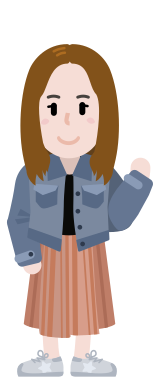
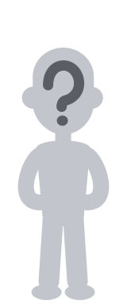
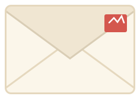
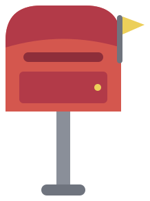

# Дизайн

[← README](../README.md)

Тёплая бумажная палитра: кремовый фон, синий для действий, коралловый для акцентов. Карточки и письма выглядят как бумага: светлая поверхность, тонкая рамка, мягкие тени, скруглённые углы.

## Палитра

| Цвет | HEX | Роль |
|---|---|---|
| Кремовый | `#FBF6EA` | фон |
| Белый | `#FFFFFF` | карточки и письма |
| Тёплый ink | `#2E2A26` | основной текст |
| Синий | `#4B84D1` | действия |
| Тёмно-синий | `#3B6CB0` | иконка, акцент |
| Коралловый | `#D4574E` | акцент |
| Зелёный | `#4F8A63` | положительная динамика |
| Приглушённый красный | `#B4544F` | отрицательная динамика |
| Рамка | `#E4DDD0` | границы |

Токены лежат в `base.css`.

## Типографика

Основной шрифт — Nunito (локальные woff2 в `fonts/`). Заголовки и кнопки набираются тем же шрифтом с большим весом; отдельного дисплейного шрифта нет.

## Персонажи и реквизит

Персонажи собираются из слоистых SVG: тело, волосы, одежда. Готовые фигуры и предметы лежат отдельно.

- `svg/layered/` — слои для конструктора;
- `svg/normalized/` — готовые фигуры, психолог, Незнакомец, письмо, ящик, мешок.

  
  

  
  
  

Всего в проекте 68 SVG. Иконки интерфейса — отдельные Vue-компоненты, без иконочного шрифта.

## Обложка

`docs/banner.svg` — баннер для репозитория и презентаций. Иконка сайта собрана из логотипа и лежит в `public/favicon.svg`.
